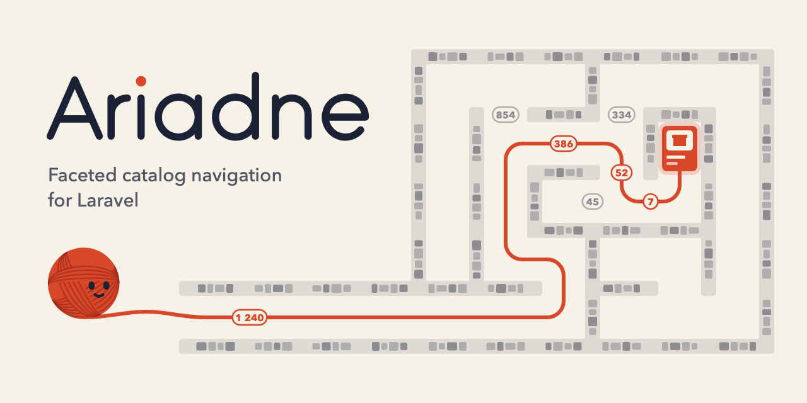

# Ariadne

<picture>
  <source media="(prefers-color-scheme: dark)" srcset="https://raw.githubusercontent.com/TimurTurdyev/ariadne/main/art/cover-dark.png">
  
</picture>

Ariadne gave Theseus a thread to find his way through the labyrinth. This package gives shoppers the thread through a catalog: every turn shows how many products lie behind it, and any choice can be undone.

## Installation

Laravel 12 or 13 on PHP 8.3+:

```bash
composer require timurturdyev/ariadne
```

Coming from 0.1, published under the previous name: [UPGRADE.md](https://github.com/TimurTurdyev/ariadne/blob/main/UPGRADE.md).

Laravel finds the provider by itself. The config is published on demand:

```bash
php artisan vendor:publish --tag=ariadne-config
```

- `catalogs`, `tables`, `sync`, `rebuild`: the catalog layer, see [a catalog in one class](#a-catalog-in-one-class).
- `manticore`: where `Manticore\Connection` connects, from `MANTICORE_HOST`, `MANTICORE_PORT`, `MANTICORE_TIMEOUT` and `MANTICORE_READ_TIMEOUT`.
- `url`: the `style` of the address (`comma` or `brackets`), the `price_unit` and the `sorts` an address accepts.
- `screen`: the `order` of values in a group (`dictionary`, `natural`, `alpha`, `count-desc`); `filtered_bounds` makes the price bounds follow the selection, not the whole scope; `keep_zeros` keeps a value nothing matches, dimmed; `palette_on_price`, together with `keep_zeros`, dims instead of hiding the values that only a price range zeroes, off by default; `min_values` is how many values a group without a selection needs to show.

The package does not know your catalog: no models, no migrations, no field names. You describe the scope, name the fields and bring the index: the SQL one that ships, or your own engine. The provider binds `Manticore\Connection`, `UrlFormat`, `QueryStringCodec` and `DisjunctivePolicy` as singletons, `SearchCatalog` and `PanelLinks` as scoped, each only when the application has not bound the class itself: your own binding wins in any provider order. Two ports are yours to bind: `CatalogIndex` runs a plan, `FacetDictionary` knows the facets and their values.

Two extensions are optional. With `intl` the `natural` and `alpha` orders use a `ru_RU` collator, without it a plain natural comparison. `pdo_mysql` is needed only for Manticore.

Two ways in. [A catalog in one class](#a-catalog-in-one-class) describes the catalog and lets the package keep the tables, the sync and the rebuilds. [The low level](#the-low-level) gives the ports and the parts for an application that keeps its own index; read [its traps](#traps) before the first screen, each of them fails silently.

## A catalog in one class

Describe the facets once; the category decides which of them appear. The package keeps the facet tables, follows your model saves, rebuilds without downtime and hands you a ready screen with models, counts and links.

```bash
php artisan ariadne:install --catalog=products --model='App\Models\Product'
php artisan migrate
php artisan ariadne:rebuild products
php artisan ariadne:check
```

`install` writes `config/ariadne.php` if you have none, the migration of the facet tables and a definition in `app/Search/ProductCatalog.php`. The migration is yours, as with `make:queue-table`: the package never loads migrations from `vendor`, so renaming a file in a release cannot drop your tables. A second run refuses when the file, its row in `migrations` or the tables exist.

### The definition

```php
namespace App\Search;

use App\Models\Product;
use Illuminate\Database\Eloquent\Builder;
use TimurTurdyev\Ariadne\Catalog\Attributes\Fields;
use TimurTurdyev\Ariadne\Catalog\Attributes\Price;
use TimurTurdyev\Ariadne\Catalog\CatalogDefinition;
use TimurTurdyev\Ariadne\Catalog\Facet;
use TimurTurdyev\Ariadne\Catalog\Sort;

/**
 * @implements CatalogDefinition<Product>
 */
#[Price('price')]
#[Fields('category_id')]
final class ProductCatalog implements CatalogDefinition
{
    public function documents(): Builder
    {
        return Product::query()->where('is_active', true);
    }

    public function facets(): array
    {
        return [
            Facet::make('brand', 'Brand', fn (Product $p): array => $p->brand === null ? [] : [$p->brand->slug => $p->brand->name])
                ->with('brand')
                ->single(),
            Facet::make('color', 'Color', fn (Product $p): array => $p->colors->pluck('name', 'slug')->all())
                ->with('colors')
                ->swatches(),
            Facet::make('size', 'Size', fn (Product $p): array => $p->size === null ? [] : [$p->size => strtoupper($p->size)]),
            Facet::toggle('sale', 'On sale', fn (Product $p): bool => $p->old_price > $p->price),
        ];
    }

    public function sorts(): array
    {
        return [
            Sort::make('popular', 'Popular', 'sales_count desc'),
            Sort::make('new', 'Newest', 'published_at desc'),
            Sort::make('price-asc', 'Cheaper first', 'price'),
            Sort::make('price-desc', 'Dearer first', 'price desc'),
        ];
    }
}
```

And the config line `install` wrote:

```php
'catalogs' => [
    'products' => ['definition' => App\Search\ProductCatalog::class, 'min_coverage' => 0.05],
],
```

- **`documents()`** is what the listing shows: the visibility conditions and the relations a card loads. No `select()`, no joins, no order.
- **A producer returns `[value => label]` or `Term` objects, and `[]` when the document has no value.** Return `[]`, not `null` and not a guess: a group appears only where some document has it.
- **The value is a stable slug from a column**, `$brand->slug`, not one made from the label. A label slug changes every address when someone renames the brand, and an old link silently loses the filter.
- **`->with()` names the relations the producer reads.** A rebuild eager loads them, and edits of these relations mark the documents for a sync.
- **`->single()`** says a document has at most one value of the facet: the panel offers no "all of" switch. **`->swatches()`** marks the widget, the image comes from `Term::of(...)->image('#d33')`.
- **`#[Price(column, unit: 100)]`** names the price column, here in cents. **`#[Fields(...)]`** lists what `where()` may narrow by: a column, a belongsTo or a belongsToMany relation. **`#[OneCardPer('model_id')]`** shows documents of one model as one card.
- **`Sort::make()`** takes columns of the model with `asc` or `desc`. A row where a sort column is NULL goes last in either direction on every database; `->nullsFirst()` turns that over. Anything else in the order is raw SQL, allowed on the database driver only. The first sort is the default: its address has no `sort`, and an explicit `?sort=` of it is dropped from links and canonical.

Keys of a catalog entry, each with a default in code: `definition`, `driver` (`database`), `per_page` (24), `keep_zeros` (true), `min_values` (2), `min_coverage` (0), `max_groups` (null), `filtered_bounds` (false), `style` (`comma`), `carry` (foreign parameters the links keep, `[]`), `cache` (a cache store for screens, null), `slug_language` (`app.locale`). A misspelled key fails with a "did you mean". The key of the entry, `products`, names the storage: it goes into table names and cache keys, so you may rename the class but not the key.

### The controller

```php
use App\Search\ProductCatalog;
use TimurTurdyev\Ariadne\Catalog\Catalogs;

public function show(Request $request, Category $category, Catalogs $catalogs)
{
    $screen = $catalogs->for(ProductCatalog::class)
        ->where('category_id', $category->descendantIds())
        ->within($category)
        ->screen($request);

    if ($screen->redirect() !== null) {
        return redirect($screen->redirect(), 301);
    }

    return view('catalog', ['category' => $category, 'screen' => $screen]);
}
```

- `where(field, values)`: `null` means no restriction, `[]` means nothing.
- `ranked($ids)` narrows to the ids of your own search, in their order: the text search stays yours, the layer runs no `q`. Without `ranked()` a `q` is dropped from the links.
- `landingOf($listingPath, ['brand' => 'acme'])` makes this request a landing page that pins values in its own path.
- `within($context)` passes the category to the panel rules, `perPage($n)` overrides `per_page`.
- `screen($request, Need::Results)` skips the panel, for "show more".

`$screen` is one object for Blade, JSON and Inertia: `items` (models in listing order), `total`, `page`, `perPage`, `facets` (groups with `facet`, `title`, `widget`, `coverage` and values with `href`, `only`, `count`, `selected`, `disabled`, `image`), `sorts`, `applied` (chips that take a filter off, the price too), `reset`, `paging`, `price`, `canonical`, `redirect()`, `degraded` and `result`, the raw `SearchResult` for your SEO rules. `paginator()` gives Laravel's paginator on these addresses, `through(fn)` maps the items for JSON.

```blade
@foreach ($screen->facets as $group)
    <h3>{{ $group->title }}</h3>
    @foreach ($group->values as $value)
        <a href="{{ $value->href }}" @class(['selected' => $value->selected, 'dim' => $value->disabled])>
            {{ $value->label }} <small>{{ $value->count }}</small>
        </a>
    @endforeach
@endforeach

@foreach ($screen->items as $product)
    <x-product-card :product="$product" />
@endforeach

{{ $screen->paginator()->links() }}
```

### The schedule

The provider schedules nothing; add the two lines yourself:

```php
use Illuminate\Support\Facades\Schedule;

Schedule::command('ariadne:sync')->everyMinute()->withoutOverlapping()->onOneServer();
Schedule::command('ariadne:rebuild')->dailyAt('04:00')->withoutOverlapping()->onOneServer();
```

Deploy with `php artisan migrate --force`, `php artisan optimize` (a broken definition stops it: the package hooks a static check into `optimize`) and `php artisan ariadne:check`; after a change of the definition run `php artisan ariadne:rebuild`.

### Facets from data and panel rules

Properties from an admin panel make one dynamic facet: every term names its own group.

```php
Facet::dynamic('props', function (Product $p): iterable {
    foreach ($p->values as $value) {
        yield Term::of($value->option->slug, $value->option->label, $value->option->sort)
            ->in($value->attribute->slug, $value->attribute->title);
    }
})->with('values.attribute', 'values.option')
  ->describedBy(fn (): iterable => Filter::query()->where('is_active', true)->get()->map(
      fn (Filter $f): Facet => Facet::named($f->slug, $f->title)->at($f->position),
  )),
```

Without `describedBy()` a group takes the title its terms carry and its place by coverage. With it, the admin table decides titles, order, widgets and which groups exist; `describedBy()` is read at a rebuild only, so after saving a filter in the admin call `$catalogs->for(ProductCatalog::class)->touchAll()`, and the next `ariadne:sync` rebuilds. Group slugs from data are checked at a rebuild: a slug that is not a slug, an all-digit one, one the address uses itself (`q`, `sort`, `page`, `price`) or one of a declared facet is refused, the rebuild and `ariadne:check` name it with the number of documents. A value that is not a slug is written as `Str::slug()` of it in `slug_language`.

A category shapes its panel through the optional interface `ShapesPanel`:

```php
public function panel(Panel $panel, mixed $context): Panel
{
    // search, sale and brand pages mix categories
    if (! $context instanceof Category) {
        return $panel->only('brand', 'color', 'sale')->max(8);
    }

    return PanelRules::apply($panel, $context);
}
```

`first`, `only`, `hide`, `show`, `max`, `minCoverage` and `byCoverage` apply in this order: `only`, `hide` and the coverage threshold; then the pinned groups (`only` or `first`); then `max`. A group with a selection is never hidden, so a filter can always be taken off; pinned groups and toggles pass the threshold. The rules of a category tree - the nearest category with its own settings wins - are your code and your table: one recursive query over the chain of categories, cached by you until the admin saves. On mixed screens (search, sale, a brand page, the root) a 5% threshold still leaves around twenty groups: use `only()` and `max()`, or the rules of the dominant category through `within($dominant)`.

### What keeps the rows fresh

Writes through Eloquent mark the documents in the transaction of the write, and the marks are applied after the response. The root model is followed on `saved`, `updated`, `deleted`, `restored` and `forceDeleted`; the relations of `->with()` paths on their own events: a belongsTo on `updated` and `deleting`, a hasMany on `created`, `updated` and `deleted` (the previous parent too, when a row moves), a belongsToMany through its pivot class only (`->using()`). One edit of a relation that touches more than 2000 documents asks for a rebuild instead.

> **What Laravel does not report**
>
> - `attach`, `detach`, `sync`, `toggle` and `updateExistingPivot` on a pivot without `->using()`;
> - `update`, `increment`, `decrement` and `delete` on a query, `Model::insert`, `upsert`, `DB::table`, `saveQuietly` and `withoutEvents`;
> - `nullOnDelete` and cascades of foreign keys;
> - writes of other applications and conditions on time, such as `now()` in a producer.
>
> After such a write call `$catalogs->for(ProductCatalog::class)->touch($ids)` (an id, a list, a query or a relation), or leave it to the nightly rebuild. `touchAll()` asks for a rebuild on the next sync.

Price, the `#[Fields]` columns, the sort columns and the visibility of `documents()` are read live from your table on every screen: hiding a product with raw SQL needs nothing. Only the facet values follow the marks.

- A counter on the root model that no producer reads, views or sales, still marks the document on every save: write it with `DB::table()->increment()` or `saveQuietly()`.
- `$catalogs->withoutSync(fn () => ...)` and `ARIADNE_SYNC=false` turn the marks off, for imports and seeders followed by a rebuild.
- `drain()` applies pending edits now, for an admin that shows its own edit in the response.
- An application upgraded from Laravel 10 with an old `app/Http/Kernel.php` may lack `InvokeDeferredCallbacks`: then edits wait for the minute sync, and `ariadne:check` says so.

Edits lag behind by the end of the request as a rule, by a minute when a drain fails, until the night when a write bypasses the events.

### Tests of your application

After seeding, run `ariadne:rebuild` or `drain()`; an edit made in a test without an HTTP request reaches the rows only through `drain()`. On SQLite and PostgreSQL a rebuild runs inside the transaction of `RefreshDatabase`; on MySQL and MariaDB its DDL would commit that transaction, so a test that rebuilds uses `DatabaseMigrations` or `DatabaseTruncation`. Set `ARIADNE_SYNC=false` where the tests do not need the facet rows.

### Operations

| command | |
|---|---|
| `ariadne:install [--catalog=] [--model=] [--upgrade]` | config, migration, definition |
| `ariadne:rebuild {catalog?*} [--force] [--wait=]` | builds a new generation and publishes it; exit 1 when the gate refused it (an empty build over a non-empty one needs `--force`), 2 on a failure, 3 when another rebuild runs |
| `ariadne:sync {catalog?*}` | the minute pass: pending marks, a requested rebuild, the previous generation after ten minutes, a flag a killed rebuild left |
| `ariadne:check [--strict] [--static]` | developer mistakes and data problems at once; exit 1 on errors, with `--strict` on warnings too; `--static` without the database |

- A rebuild fills a new table next to the live one and publishes it by moving a pointer, so readers never see a half-built table and never wait. Edits made during the fill are replayed into the new table right before the switch.
- The database user needs the right to create and drop tables. Locks need a cache store with locks shared by every server (`sync.lock_store`; redis, memcached or database), and `rebuild.lock_seconds` longer than the longest rebuild.
- On PostgreSQL lower `random_page_cost` (1.1 on SSD): with the default 4 small categories are planned as a hash join over every product, 39 instead of 16 ms per screen in the measurements of the prototype.
- On SQLite switch the database to WAL: in rollback journal mode a rebuild blocks readers.
- `cache` in a catalog entry caches screens in that store: the key includes the generation and a version that grows with every sync, so every edit, a stock change by an order included, cools all screens of the catalog. Cache screens of catalogs that change rarely.
- `migrate:rollback` drops the facet tables with the generations; `ariadne:rebuild` brings them back, and the addresses stay, since they are made of slugs.

### How far the database goes

Measured on an M5 Pro laptop with the database local, 14 groups per screen, MariaDB 12.3 and PostgreSQL 18.6, p50 of 15 screens:

| | 100k products, 665k facet rows | 300k products, 2M facet rows |
|---|---|---|
| a category of 300-430 products | 3-8 ms | 4-12 ms |
| the root, no selection / three values selected | MariaDB 138 / 193 ms, PostgreSQL 104 / 177 ms | MariaDB 487 / 720 ms, PostgreSQL 110 / 177 ms |
| rebuild | MariaDB 10 s, PostgreSQL 14 s | MariaDB 31 s, PostgreSQL 33-49 s |
| sync of 100 edited products | 19-41 ms | 19-30 ms |

A screen costs what its scope holds, not what the catalog holds: categories stay fast at any size. The root and the large categories grow with the catalog; on PostgreSQL parallel aggregation keeps them flat, on MariaDB and SQLite they pass half a second around 300k products. That is the point to move to Manticore, the driver of 0.4, which costs about the same on every scope.

Names: `ProductCatalog` is the definition, `Catalog<Product>` the catalog at work, the key `products` the storage. The words catalog in `SearchCatalog` and `SqlCatalog` below belong to the low level, which a catalog in one class does not need.

## The low level

Everything below is what the catalog layer is built on, for an application that keeps its own index and tables: the ports, the flat table, the panel with links and the Manticore tables. An application on the catalog layer does not need it.

## SQL facets on a flat table

No search engine: facets are counted in your database over one flat table, a row per filter value of a document. The table is yours, and so is the code that fills it:

```php
use Illuminate\Database\Schema\Blueprint;
use Illuminate\Support\Facades\Schema;

Schema::create('item_facets', static function (Blueprint $table): void {
    $table->unsignedBigInteger('item_id');
    $table->string('facet', 64);                         // color, pack-size
    $table->string('value', 96);                         // white, 62
    $table->string('label');                             // White
    $table->unsignedInteger('sort_value')->default(0);   // order inside the group

    $table->primary(['item_id', 'facet', 'value']);
    $table->index(['facet', 'value', 'item_id']);
});
```

The columns `facet`, `value`, `label` and `sort_value` are fixed; the table name and the document column are yours. On MySQL and MariaDB add `->collation('utf8mb4_bin')` to `facet` and `value`.

- The index ends with the document column. A selection looks documents up by facet and value, and on SQLite and PostgreSQL selective screens ran two to five times faster than with an index on `(facet, value)`. On InnoDB it changes nothing: a secondary index carries the primary key anyway.
- There is no foreign key: it slowed the fill down by 18% on MariaDB and 28% on PostgreSQL. So the rows of a deleted document are removed by the code that deletes it. Counts would not see them, they go through your documents, but the dictionary reads the whole table, and an old link with such a value would show the filter selected with a zero.

The snippets here assume a plain shop: `items` with `id`, `name`, `active`, `price` in cents, `sales`, `brand_id`, a nullable `model_id`, `color` and `size`; `brands` with `id` and `name`; an `item_section` pivot of `item_id` and `section_id`; the models `Item` with a `brand()` relation, `Brand`, and `Section` with a `slug`. The fill rewrites the rows of an item whenever it is saved and removes them when it is deleted:

```php
use App\Models\Item;
use Illuminate\Support\Facades\DB;
use Illuminate\Support\Str;

// In the boot() of a service provider.
Item::saved(static function (Item $item): void {
    DB::transaction(static function () use ($item): void {
        DB::table('item_facets')->where('item_id', $item->id)->delete();
        DB::table('item_facets')->insert([
            ['item_id' => $item->id, 'facet' => 'color', 'value' => Str::slug($item->color), 'label' => $item->color, 'sort_value' => 0],
            ['item_id' => $item->id, 'facet' => 'size', 'value' => (string) $item->size, 'label' => $item->size.' cm', 'sort_value' => $item->size],
        ]);
    });
});

Item::deleted(static fn (Item $item): int => DB::table('item_facets')->where('item_id', $item->id)->delete());
```

`value` must be a slug, `[a-z0-9]+(-[a-z0-9]+)*`, which `Str::slug()` makes of a label, and `facet` a slug in the key style of `FacetTable`, kebab by default (see [address styles](#address-styles)); a row with anything else is skipped with a warning. A mass `update()` or `delete()` on a query fires no model events, so the code that runs one refills or deletes those rows itself.

Then tell the package about your tables in a service provider:

```php
use App\Models\Item;
use Illuminate\Database\Query\Builder;
use Illuminate\Support\Facades\DB;
use Psr\Log\LoggerInterface;
use TimurTurdyev\Ariadne\Dictionary\FacetDictionary;
use TimurTurdyev\Ariadne\Index\CatalogIndex;
use TimurTurdyev\Ariadne\Query\Constraint;
use TimurTurdyev\Ariadne\Query\Query;
use TimurTurdyev\Ariadne\Sql\FacetTable;
use TimurTurdyev\Ariadne\Sql\FlatFacetDictionary;
use TimurTurdyev\Ariadne\Sql\SqlCatalog;
use TimurTurdyev\Ariadne\Sql\SqlCatalogIndex;

$table = new FacetTable('item_facets', 'item_id');

$this->app->scoped(FlatFacetDictionary::class, static fn ($app): FlatFacetDictionary => new FlatFacetDictionary(
    $app->make('db')->connection(),
    $table,
    ['size' => 'Size', 'color' => 'Color'],   // group titles, in panel order
    $app->make(LoggerInterface::class),
));
$this->app->scoped(FacetDictionary::class, static fn ($app): FacetDictionary => $app->make(FlatFacetDictionary::class));

$this->app->scoped(CatalogIndex::class, static fn ($app): CatalogIndex => new SqlCatalogIndex(
    new SqlCatalog(
        documents: static fn () => Item::query()->where('items.active', true),
        id: 'items.id',
        price: 'items.price',
        fields: [
            'id' => 'items.id',
            'brand' => 'items.brand_id',
            'sections' => static fn (Builder $query, Constraint $constraint) => $query->whereIn(
                'items.id',
                DB::table('item_section')->whereIn('section_id', $constraint->values)->select('item_id'),
            ),
        ],
        sorts: [
            '' => static function (Query $query): string {
                $found = $query->scope->constraint('id');   // on a search screen: ids in ranking order

                return $found !== null && $found->ranked
                    ? SqlCatalog::rankedOrder('items.id', array_map(intval(...), $found->values))
                    : 'items.sales DESC';
            },
            'price-asc' => 'items.price',
        ],
        groups: ['model' => 'COALESCE(items.model_id, -items.id)'],
    ),
    $table,
    $app->make(FlatFacetDictionary::class),
));
```

List `price-asc` in `url.sorts` of the config too, or the address never reads it.

What `SqlCatalog` expects:

- `id`, `price` and the strings in `fields`, `sorts` and `groups` go into SQL as they are: never take them from a request. The table prefix of the connection is not applied to them, unlike the names in `FacetTable`. `id` and `price` are required and written with their table. `price` may be an expression, such as `COALESCE(items.sale_price, items.price)`: the filter bounds go in as numbers.
- `documents` gives the visible documents before any scope or selection. Its rows must carry the id column; its own order is dropped, the order comes from `sorts` alone. Put a top-level OR in brackets yourself, `where(fn ($q) => $q->where(...)->orWhere(...))`, or the filters stick to its last condition only.
- A field is a column for an IN list or a closure with its own condition, which gets the base query builder, not the Eloquent one; its conditions are put in brackets for you. A scope field missing from `fields` is a `LogicException`; an empty constraint matches nothing.
- A sort is an ORDER BY list or a closure of the `Query` that returns one. The adapter adds the id as the last key itself, so with equal sort values the pages and the card of a group do not depend on the query plan.
- A group expression names the card of a row and must never be NULL. The card is the row that comes first under the current sort and selection; the total and the counts are then in cards.

A controller of a section page:

```php
use App\Models\Item;
use App\Models\Section;
use Illuminate\Http\Request;
use Illuminate\View\View;
use TimurTurdyev\Ariadne\Dictionary\FacetDictionary;
use TimurTurdyev\Ariadne\Present\LinkBase;
use TimurTurdyev\Ariadne\Present\PanelLinks;
use TimurTurdyev\Ariadne\Query\Constraint;
use TimurTurdyev\Ariadne\Query\Scope;
use TimurTurdyev\Ariadne\Results\Hit;
use TimurTurdyev\Ariadne\Search\SearchCatalog;
use TimurTurdyev\Ariadne\Url\QueryStringCodec;

final class SectionController
{
    public function __invoke(
        Request $request,
        Section $section,
        QueryStringCodec $codec,
        FacetDictionary $dictionary,
        SearchCatalog $catalog,
        PanelLinks $links,
    ): View {
        $scope = new Scope('section', [Constraint::in('sections', [$section->id])]);
        $query = $codec->decode($request->query(), $scope, $dictionary, perPage: 24);
        $screen = $catalog($query);

        // The rows of the page are already read and in order: no second query, no sorting.
        $items = Item::hydrate(array_map(static fn (Hit $hit): array => $hit->attributes, $screen->page->hits));

        $base = LinkBase::of($request->getPathInfo(), $request->query(), $codec, $dictionary)->only('sale');

        return view('catalog.section', [
            'items' => $items->load('brand'),
            'total' => $screen->page->total,
            'panel' => $links->panel($screen, $base, sorts: ['' => 'Popular', 'price-asc' => 'Cheapest first']),
            'degraded' => $screen->degraded,
        ]);
    }
}
```

The route binds the section by its slug, which gives the addresses below, such as `/catalog/desks`:

```php
use App\Http\Controllers\SectionController;
use Illuminate\Support\Facades\Route;

Route::get('/catalog/{section:slug}', SectionController::class);
```

The screen holds:

```php
$screen->page->hits;      // list of Hit: id, attributes, payload, extra
$screen->page->total;
$screen->panel->groups;   // facets with values, counts and states
$screen->priceBounds;     // for the price slider
$screen->degraded;        // true when the index did not answer
```

`Hit::$attributes` is the row `documents` gave, so `hydrate()` makes the models of the page in its order, marked as existing. If `documents` joins another table, select `items.*` in it, or foreign columns get into the models. The panel is described in [the panel with ready links](#the-panel-with-ready-links).

A scope is the part of a query the buyer does not choose: a label of the screen kind, constraints by field and an optional grouping key (`groupBy: 'model'` asks for one card per model). The page size is the fourth argument of `decode()`, 30 by default, and it is never read from the address. A page that loads its panel with a second request asks for the halves separately: `$query->needing(Need::Results)` skips the counts, `Need::Panel` skips the documents.

The search text is not run here. Run it wherever you like and pass the ids in ranking order:

```php
use TimurTurdyev\Ariadne\Query\Constraint;
use TimurTurdyev\Ariadne\Query\Scope;

$ids = $search->ids((string) $request->query('q'));   // your search: ids by relevance

$scope = new Scope('search', [Constraint::ranked('id', $ids)]);
$query = $codec->decode($request->query(), $scope, $dictionary);
```

`Constraint::ranked()` narrows the scope to those ids, and the `id` field in `fields` is there for it. The default sort of the example keeps their order through `SqlCatalog::rankedOrder()`.

The dictionary reads the table with one query per instance and caches nothing: an edit shows at once. Its term ids mean something only inside that instance, which is why the index and the port share one scoped dictionary. Groups go in the order of the titles, the rest by name; values by `sort_value`, then by label. A facet or a value that is not a slug is skipped with a warning to the logger of the fourth argument. A screen costs 5 queries without a selection and 6 + k with a selection in k facets, the dictionary included; with `palette_on_price` a screen with a price alone costs 6.

## Your own engine behind CatalogIndex

Write the adapter and bind it next to a dictionary:

```php
use App\Search\DbFacetDictionary;
use App\Search\EngineCatalogIndex;
use TimurTurdyev\Ariadne\Dictionary\FacetDictionary;
use TimurTurdyev\Ariadne\Index\CatalogIndex;

$this->app->scoped(FacetDictionary::class, DbFacetDictionary::class);
$this->app->bind(CatalogIndex::class, EngineCatalogIndex::class);
```

`execute(QueryPlan $plan): IndexResponse` receives the intents of one screen. Each carries its own `Query` with the right filters already dropped, so the adapter compiles and runs it without guessing:

| Intent | Key | Its query | What to answer |
|---|---|---|---|
| main | `main` | as the buyer asked | hits unless `isAggregateOnly()`, the total, counts of every facet |
| price bounds | `price-bounds` | scope and text; with `filtered_bounds` everything but the price | the lowest and the highest price |
| palette | `palette` | scope and text | counts: the values that exist in the scope at all |
| what-if | `what-if:color` | everything but the choice in `color` | counts of that facet |

Only main always comes. Price bounds come with the panel, a what-if with every selected facet. The palette comes when something is selected, and with `palette_on_price` also when only a price is set: do not take it for a sign of a selection. Counts go into `IndexResponse` under the intent key as `term id => count`, in the term ids of your dictionary. Facet and value ids are strict slugs, `[a-z0-9]+(-[a-z0-9]+)*`; an address with an unknown one loses that filter and nothing else.

An unreachable engine is a `CatalogIndexUnavailable`, a broken query surfaces as it is. The screen then comes back empty and marked `degraded`: show an outage, not "nothing found, reset the filters". Such a screen is never cached. `Manticore\Connection` behaves so. It reads the first byte of the handshake before connecting, so a dead engine behind a live port does not hold a worker. After a dropped link (`wait_timeout`, an engine restart) it connects again by itself: a statement that never reached the engine is retried once, one cut off in the middle is a `CatalogIndexUnavailable`. Bindings of `query()` and `select()` send ints and bools as numbers and the rest as strings; put floats and lists into the SQL text.

`MANTICORE_TIMEOUT` is the time to connect, empty or 0 means 5 seconds. `MANTICORE_READ_TIMEOUT` is the time to answer, 30 seconds by default: an answer that does not come in time is a `CatalogIndexUnavailable` without a retry, so a hung engine does not hold a worker either. It applies to the Manticore connection only: the package sets `mysqlnd.net_read_timeout` while the connection opens and puts the old value back at once, so the database connection of the application keeps its own. Waiting on the network does not count toward `max_execution_time`, so keep the timeout above your longest legitimate statement. 0 leaves the process setting (86400 seconds by default), and then a long statement is retried once when it runs out: mysqlnd reports that as a dropped link. `MANTICORE_HOST=localhost` connects to `127.0.0.1` over TCP.

Two things are left out on purpose. Search cascades: synonyms, typo correction, a retry in the other keyboard layout and a fallback to LIKE differ from shop to shop and stay in the application. The package only gives the bricks: `withPrefix()` on a query, `Manticore\Connection`, and `Text\Layout::toCyrillic('rjv,bytpjy')` for `комбинезон`. And the query compiler: turning a plan into SphinxQL for your tables is the adapter you write. The only adapter that ships is the SQL one.

## Traps

> Each of these fails silently.
>
> - **A sort is declared in three places.** `url.sorts` in the config lets the address read the slug, `sorts` of `SqlCatalog` or your adapter orders by it, and the labels passed to `PanelLinks::panel()` offer it in the panel. Miss one, and the sort quietly does nothing.
> - **`sort_value` orders the values of a group only with `screen.order` set to `dictionary`.** The default, `natural`, orders them by label.
> - **Foreign parameters ride along in every link** unless you name the ones to keep: `$base->only('sale')`. Without `LinkBase::only()` the `_token`, `partial` and any stray parameter get into the panel addresses.
> - **A price range alone hides values instead of dimming them.** With `keep_zeros` a value nothing matches stays in the panel, dimmed, but only when the screen has a palette, and without a selected facet it has none: a value that only the price zeroes is not in the panel at all, and neither is a group left with no values. `palette_on_price` adds the palette to such screens. It is off by default: the extra count made a screen with a price alone 1.5 to 2.3 times slower on the flat table, measured on 10k and 100k facet rows on SQLite, MariaDB and PostgreSQL.
> - **MySQL and MariaDB need a binary collation** (`utf8mb4_bin`) on `facet` and `value`. Without it the database merges `Acme` and `acme`, and if the spelling left is not a slug, the term drops out of the dictionary together with its documents.
> - **Your config is merged with the package one at the top level only.** A section you override needs all of its keys: without `price_unit` the unit becomes 1, without `sorts` the address takes no sort at all.
> - **The screen cache keeps arrays and scalars.** With a cache, an object of any other class in `Hit::$attributes`, `Hit::$payload` or `Hit::$extra` comes back as `__PHP_Incomplete_Class`, see [screen cache](#screen-cache).

## Address styles

| | `comma` | `brackets` |
|---|---|---|
| Address | `?color=black,white&price=1000-50000&sort=price-asc` | `?color[]=black&color[]=white&price_min=1000&price_max=50000&sort=price-asc` |
| Facet keys | kebab: `pack-size` | snake: `pack_size` |
| All of the values at once | `material=all:leather,mesh` | no |

`comma` is the compact one. `brackets` is what an HTML form submits, so a filter form works without scripts: `key[]=a`, `key[0]=a` and `key=a` read alike, and a nested array or `sort[]` costs the buyer that parameter instead of a 500. `encode()` escapes the brackets: `color%5B%5D=black`.

`encode()` writes the canonical query string: text, facets by parameter name with values in alphabetical order, price, sort, page; defaults are left out. `price_unit` is the number of base units in one unit typed in the address: with prices kept in cents it is 100, and `price=1000-50000` means 100000 to 5000000. A reversed range `500-100` reads as `100-500`. A bound above `QueryStringCodec::MAX_AMOUNT` (1e12 in address units) or not a number is not read, a fractional one is rounded to two decimals. A sort outside `sorts` reads as the default order. Unlike facet keys, a sort slug is never respelled: both styles write and read it exactly as `url.sorts` lists it.

The codec keeps `q`, `sort`, `page` and the price parameters for itself. `isReserved()` takes a facet slug and tells a slug generator that the address could not read it: in `brackets` `price-min` is taken too, since it becomes `price_min`, and an all-digit slug is taken in both styles. Whatever else is not a known facet is foreign, such as campaign tags and your own flags: `foreign()` returns it and every panel address carries it on. `canonical()` orders incoming parameters the same way, for a redirect to one address per selection; facet values that cannot be a slug are dropped, so `canonical(canonical(x))` equals `canonical(x)`.

The key style of `FacetTable` is how your fill spells the `facet` column; the address style does not change it. Kebab, the default, reads `pack-size`, and a `brackets` address still says `pack_size`. With `brackets`, `$format->keys()` is snake: pass it only when the fill writes `pack_size`, and key the titles of `FlatFacetDictionary` the same way. A name the key style cannot read is skipped with a warning, and every value of that facet with it.

## The panel with ready links

The panel is disjunctive: picking one color does not zero the other colors. A selected value never leaves the panel, so a filter can always be taken off. Every address - a value, a reset, a sort, a page - is built on the server, and one selection always gives one address.

```php
use TimurTurdyev\Ariadne\Present\LinkBase;

$base = LinkBase::of($request->getPathInfo(), $request->query(), $codec, $dictionary)->only('sale');

$panel = $links->panel($screen, $base, sorts: ['' => 'Popular', 'price-asc' => 'Cheapest first']);
```

`$links` is the `PanelLinks`. The answer is a plain array, for Blade and Inertia alike. Here it is, abridged, for `/catalog/desks?color=black,white&price=1000-&sort=price-asc` with prices kept in cents:

```php
[
    'facets' => [[
        'facet' => 'color', 'label' => 'Color', 'operator' => 'any', 'selected' => 2,
        'reset' => '/catalog/desks?price=1000-&sort=price-asc',
        // The same choice with the other operator; null when there is nothing to switch.
        'operatorHref' => '/catalog/desks?color=all:black,white&price=1000-&sort=price-asc',
        'values' => [[
            'value' => 'white', 'label' => 'White', 'image' => null, 'count' => 5, 'selected' => true, 'disabled' => false,
            'href' => '/catalog/desks?color=black&price=1000-&sort=price-asc',   // the value toggled
            'only' => '/catalog/desks?color=white&price=1000-&sort=price-asc',   // this value alone in its group
        ]],
    ]],
    'reset' => '/catalog/desks?sort=price-asc',   // no facets and no price; text and sort stay
    'sorts' => [['value' => 'price-asc', 'label' => 'Cheapest first', 'href' => '...', 'selected' => true]],
    'paging' => ['first' => '...', 'prev' => null, 'next' => '...', 'template' => '...&sort=price-asc&page={page}'],
    'price' => [
        'reset' => '/catalog/desks?color=black,white&sort=price-asc',
        'input' => ['min' => '1000', 'max' => ''],             // as typed in the address
        'template' => '/catalog/desks?color=black,white&price={min}-{max}&sort=price-asc',
        'bounds' => ['min' => 99000.0, 'max' => 12500000.0],   // base units, like selected
        'selected' => ['min' => 100000.0, 'max' => null],
    ],
]
```

The view `catalog.section` of the controller above comes down to this:

```blade
@if ($degraded)
    <p>The catalog is not answering. Try again in a minute.</p>
@endif

@foreach ($panel['facets'] as $group)
    <h3>{{ $group['label'] }} @if ($group['selected']) <a href="{{ $group['reset'] }}">reset</a> @endif</h3>
    @foreach ($group['values'] as $value)
        <a href="{{ $value['href'] }}" @class(['selected' => $value['selected'], 'dimmed' => $value['disabled']])>{{ $value['label'] }} {{ $value['count'] }}</a>
    @endforeach
@endforeach

@foreach ($panel['sorts'] as $sort)
    <a href="{{ $sort['href'] }}" @class(['selected' => $sort['selected']])>{{ $sort['label'] }}</a>
@endforeach

<p>Found: {{ $total }}</p>
@foreach ($items as $item)
    <article>{{ $item->name }}, {{ $item->brand->name }}</article>
@endforeach

@if ($panel['paging']['prev']) <a href="{{ $panel['paging']['prev'] }}">Back</a> @endif
@if ($panel['paging']['next']) <a href="{{ $panel['paging']['next'] }}">Next</a> @endif
```

A change of the selection starts paging over, and the first page goes without `page`. On the deepest page an address can reach (`PageRequest::MAX_PAGE`, 500) there is no `next`. On a page past the last one, `prev` leads to the last page. `$links->href($query, $base)` is the address of any query, on its first page. For a panel answered to a `Need::Panel` query pass the buyer's query third, or the addresses lose their sort.

`LinkBase` brings the path to one leading slash itself, so `getPathInfo()` can go in as it is. `only()` keeps the named foreign parameters, `$base->without('sale')` drops one. The foreign part of a link is at most `LinkBase::MAX_FOREIGN_LENGTH`, 1024 encoded bytes: a parameter that does not fit is left out of the links. A foreign array does not get into `comma` links, and in `brackets` a keyed array (`filter[stock]=1`) comes back as a list, `filter[]=1`.

A landing page keeps part of the selection in its path. Say so, and its addresses stay on that path:

```php
use TimurTurdyev\Ariadne\Facets\FacetId;
use TimurTurdyev\Ariadne\Facets\FacetValueId;
use TimurTurdyev\Ariadne\Present\LinkBase;
use TimurTurdyev\Ariadne\Query\FacetChoice;
use TimurTurdyev\Ariadne\Query\Selection;

$size = new FacetChoice(FacetId::fromString('size'), [FacetValueId::fromString('62')]);

$query = $codec->decode($request->query(), $scope, $dictionary);
$query = $query->withSelection($query->selection->with($size));

$base = LinkBase::of('/catalog', $request->query(), $codec, $dictionary)
    ->landing('/catalog/size-62', new Selection([$size]));
```

While the query keeps the pinned choice as it is, paging, sorting and other facets stay on the landing path and leave the pinned facet out: `/catalog/size-62?page=2`, `/catalog/size-62?color=white`. Once the pinned choice changes, a value taken off or another one added, the address goes to the main path with the whole selection: `/catalog?size=62,68`. A landing page that pins nothing does not apply, and its addresses go to the main path.

## Screen cache

The provider binds `SearchCatalog` without a cache. To get one, bind the class yourself and pass a cache repository. Your binding replaces the one of the provider as a whole, so pass the logger and the `screen` settings of the config too:

```php
use Psr\Log\LoggerInterface;
use TimurTurdyev\Ariadne\Dictionary\FacetDictionary;
use TimurTurdyev\Ariadne\Facets\DisjunctivePolicy;
use TimurTurdyev\Ariadne\Facets\ValueOrder;
use TimurTurdyev\Ariadne\Index\CatalogIndex;
use TimurTurdyev\Ariadne\Search\SearchCatalog;

$this->app->scoped(SearchCatalog::class, static fn ($app): SearchCatalog => new SearchCatalog(
    $app->make(CatalogIndex::class),
    $app->make(FacetDictionary::class),
    $app->make(DisjunctivePolicy::class),
    cache: $app->make('cache')->store(),
    log: $app->make(LoggerInterface::class),
    order: ValueOrder::from(config('ariadne.screen.order')),
    filteredBounds: (bool) config('ariadne.screen.filtered_bounds'),
    paletteOnPrice: (bool) config('ariadne.screen.palette_on_price'),
));
```

The controller then passes the price scale and the key parts with the query:

```php
use TimurTurdyev\Ariadne\Query\PriceScale;

$screen = $catalog($query, new PriceScale(1.22), ['region:'.$region->id]);
```

A screen is fresh for 300 seconds, then served stale while it refreshes, and gone after 600. The key is the signature of the query, the price scale and the parts you pass: put there everything else the answer depends on, a region or a host, or one buyer gets the screen of another. A `degraded` screen is never cached. If the engine is down when a stale screen refreshes, the old one stays: it counts as fresh for another 300 seconds, the logger gets a warning and the error handler gets nothing, so while the engine stays down the stale screen keeps living. With a scale other than 1 the package rescales the filter bounds and the slider; the prices inside hits are yours, through the `displayPrices` closure.

The screen goes into the cache as a `serialize()` string and is read back with the classes of the package alone, whatever `cache.serializable_classes` allows, `false` of a fresh Laravel 13 application included. The keys start with `ariadne:screen:v2:`. An entry that does not read back is a miss, and the screen is built anew. So with a cache `Hit::$attributes`, `Hit::$payload` and `Hit::$extra` must hold arrays and scalars only: an object of any other class comes back as `__PHP_Incomplete_Class`, and that is not a miss, the screen is served with it. Database rows are fine; models hydrated from the rows of a cached screen are as old as the screen.

The dictionary is not a part of the key, and neither are the `screen` settings. A renamed value, a new one or a new order reaches cached screens with a delay of up to ten minutes, and so does a changed `screen.*` key: clear the cache after such a change, or a toggled flag seems to do nothing. If the dictionary delay hurts, pass a generation of your dictionary among the key parts, any string that changes when the dictionary does, or leave the screen uncached.

## Rebuilding Manticore tables without downtime

The application gives the documents; the package writes them in batches into a table aside, checks the count and switches the readers.

```php
use TimurTurdyev\Ariadne\Manticore\SwapCopies;
use TimurTurdyev\Ariadne\Manticore\Table;
use TimurTurdyev\Ariadne\Manticore\Writer;

$tables = [new Table(['title' => 'text', 'price' => 'int', 'sections' => 'multi'], ['min_infix_len' => '2'])];

$publication = new SwapCopies(
    $engine,   // Manticore\Connection
    $locks,    // a LockProvider, such as Cache::store()->getStore()
    read: static fn (string $name): ?string => $pointers->get($name),
    write: static function (string $name, string $table) use ($pointers): void {
        $pointers->put($name, $table);
    },
);

// $documents: rows like ['id' => 1, 'title' => 'Desk', 'price' => 150000, 'sections' => [10, 11]]
$published = $publication->rebuild('items', $tables, static fn (string $target): int => (new Writer($engine))
    ->insert($target, ['id', 'title', 'price', 'sections'], $documents));

$publication->live('items');   // the table readers query now: items_a or items_b
```

A `Table` with a `suffix` is a companion: tables of one set are published together, and the fill writes each of them at `$table->name($target)`. Write table names in lower case, the engine lower-cases them anyway.

`Writer` writes batches of 1000. A string column needs a string: a number there is stored as an empty string. NAN and INF are a `LogicException`, a NUL byte is stripped from strings. An integer above uint32 in an `int` column wraps around silently, that is the engine.

Both strategies pass the same gate before the switch: the new main table must hold exactly as many documents as the fill reported, and an empty table of the set never replaces one that has documents. A failed gate is a `PublishRefused`, an exception from the fill flies as it is; either way readers keep the previous data, and the table that was being built stays for a look until the next rebuild drops it.

A lock keeps two rebuilds of one name apart: `SwapCopies` waits for the running one up to `waitSeconds` (300), `AttachShadow` gives up at once, and both end in a `LockTimeoutException`. The lock lives for `lockSeconds`, 600 and 3600 by default: give it more than your longest rebuild takes. If a fill takes longer anyway, there is no switch but a `PublishRefused` saying the lock expired, since by then another process may hold it. `lockSeconds: 0` is a lock without expiry and without that check. The lock keys start with `ariadne.rebuild.`, and `lockPrefix` changes that.

`SwapCopies` keeps two copies, `items_a` and `items_b`, and a pointer you store wherever you like. A rebuild fills the spare copy and moves the pointer. The previous copy is left alone, so a query started before the switch finishes on it.

`AttachShadow($engine, $locks)` is for a table several applications read by a constant name, where a shared pointer does not reach them all. It builds `items_build` and runs `ATTACH TABLE items_build TO TABLE items WITH TRUNCATE`. Mind what ATTACH is:

- It needs an engine that attaches one RT table to another.
- The truncated target takes the columns and the text settings of the source. So a change of the schema is published by the same switch: readers go from the old table to the new one with no gap, and nothing has to be dropped.
- The target keeps its own value of 14 settings (seen on 29.0.2): `expand_keywords`, `rt_mem_limit`, `optimize_cutoff`, `regexp_filter`, `access_plain_attrs`, `access_blob_attrs`, `access_doclists`, `access_hitlists`, `access_dict`, `read_buffer_docs`, `read_buffer_hits`, `preopen`, `diskchunk_flush_write_timeout`, `diskchunk_flush_search_timeout`. Name such a setting in the third argument of `Table`, and after the attach it is set with ALTER when the value differs; otherwise a new value never reaches the live table. To remove such a setting, keep the key in the settings and in the third argument with its default value, such as `expand_keywords='0'`.
- `regexp_filter` and changing settings do not mix: on 29.0.2 any ALTER of a setting takes the filter off the table, for new documents too. `regexp_filter` itself only goes away with the table.
- It empties the target first and nothing rolls that back. A failure on the switch is a `PublishFailed`: if `$e->switched`, the table `$e->table` already serves the new data; if not, it holds the previous data, or nothing when ATTACH broke off in the middle.
- The switch is atomic only within one table: a set of several tables is switched one by one. Tables before the failed one are already on the new data, and the next rebuild brings the set together.
- A write that reaches the live table while the shadow is being filled is gone after the switch. Hold such writes until the rebuild ends, or run them again after it.
- ATTACH goes through a table under FREEZE and deletes the files promised to a backup. Keep `manticore-backup` and rebuilds apart in time.

If the engine went down in the middle of a fill, CREATE of a new table may run into "directory is not empty". Remove the table folder in `data_dir` by hand then, the package does not.

`Table::drift()` tells how a live table differs from the schema, by what `DESCRIBE` and `SHOW CREATE TABLE` print: a check for a deploy, not a step of the rebuild. A setting the schema does not have is an `unexpected setting`, and sizes such as `256M` are compared in bytes. The engine does not print everything and prints some things its own way, and the package does not work around these:

- a default value is not printed (`min_infix_len='0'`, `html_strip='0'`, `dict='keywords'`, `min_word_len='1'`), so such a setting in the schema shows up as `setting ...: expected`; `index_exact_words='1'` without a morphology is dropped by the engine;
- `stopwords`, `wordforms` and `exceptions` are printed as lists, `stopwords_list`, `wordforms_list` and `exceptions_list`, so drift reports both `expected` and `unexpected setting`;
- `preopen='1'` is printed as `true`, and `index_field_lengths='1'` adds columns named `<field>_len`.

Declare reserved column names (`order`, `limit`, `facet` and others) in backticks: ``'`order`' => 'int'``. Drift compares them without the backticks.

## Development

```bash
composer test
composer analyse
composer lint
```

Feature tests run on SQLite in memory, the Manticore tests on a double of the engine. The same writes and publications run on a real engine when you point at one:

```bash
ARIADNE_MANTICORE=127.0.0.1:9306 vendor/bin/pest tests/Feature/Manticore
```

Without the variable these cases are skipped. They drop every table whose name starts with `ariadne_it_`, before and after each case, so point them at an instance of their own.

The catalog layer is checked against a naive model of the screen on random addresses, and its sync against fresh rebuilds after random edits, on SQLite in the suite. MariaDB and PostgreSQL join when you name a separate instance, with a database `ariadne_test` and a passwordless `root` or `postgres`:

```bash
ARIADNE_MARIADB=127.0.0.1:33999 ARIADNE_PGSQL=127.0.0.1:55999 vendor/bin/pest tests/Feature/Catalog
```

These tests drop every table whose name starts with `shop_` or `facet_` in that database.

MIT license.
